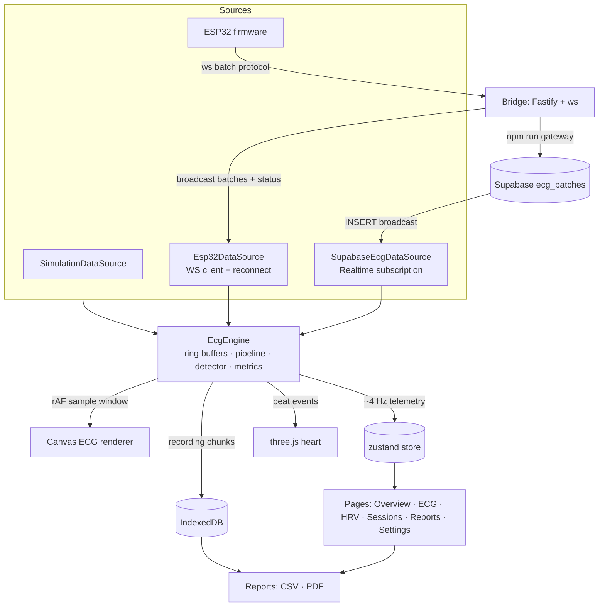
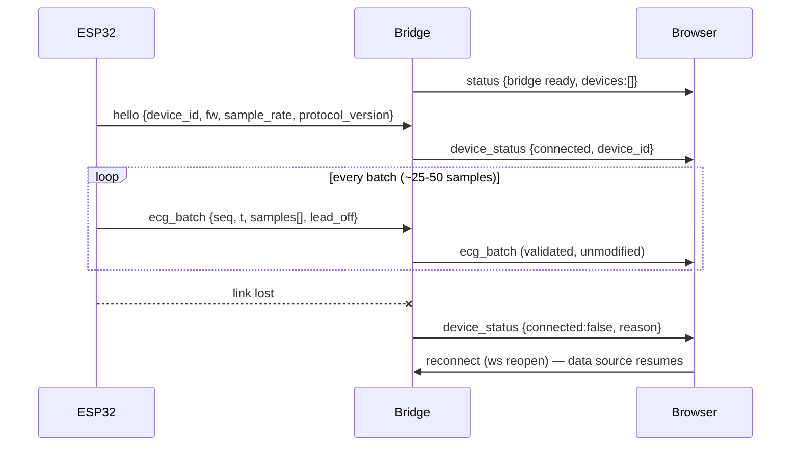

# SYSTEM ARCHITECTURE — CARDIOPULSE

## 1. Context

```
AD8232 ──analog──▶ ESP32 ADC ──Wi-Fi/WSS──▶ local bridge (Node) ──WS──▶ browser (React)
                                                   ▲
                                          mDNS / UDP discovery
```

Hosted deployment (no local server reachable from the browser):

```
AD8232 ──analog──▶ ESP32 ADC ──Wi-Fi──▶ local bridge ──WS──▶ gateway ──HTTPS──▶ Supabase Postgres
                                                                                    │ Realtime
                                                                                    ▼
                                                                             browser (React)
```

The browser never scans the LAN and never talks to the device directly; the local bridge owns device
connectivity. Without a device, `SimulationDataSource` feeds the same downstream pipeline, so the UI
has no hardware dependency.

## 2. Layers



| Layer | Location | Responsibility | Must not |
| --- | --- | --- | --- |
| Presentation | `src/app`, `src/features`, `src/components` | Layout, pages, controls, charts | filter, detect beats, open sockets |
| State | `src/state` | Settings, UI state, throttled telemetry, toasts | hold sample arrays |
| Source abstraction | `src/data`, `src/types/source.ts` | Emit `EcgBatch`, report `SourceStatus` | depend on React |
| Signal engine | `src/engine`, `src/signal` | Buffers, filters, detection, metrics, quality | touch DOM or React |
| Persistence | `src/storage` | IndexedDB sessions and chunked samples | compute metrics |
| Reporting | `src/services` | CSV/PDF generation from stored sessions | mutate sessions |
| Bridge | `server/src` | Device transport, validation, discovery, broadcast | process signals, persist data |
| Cloud transport | `src/data/supabaseSource.ts`, `src/lib/supabase.ts` | Subscribe to `ecg_batches` via Realtime, validate rows, emit `EcgBatch` | write rows, filter signals, hold a secret key |
| Firmware | `firmware/` | Timed ADC acquisition + batch transport | block on network in the sampling path |

## 3. Data contracts

```ts
interface EcgBatch {
  deviceId: string;
  seq: number;              // monotonically increasing per device
  sampleRateHz: number;     // measured/reported by the device, never assumed
  deviceTimeMs: number;     // device clock at first sample of the batch
  samples: Int16Array;      // raw ADC counts
  leadOffPos: boolean;
  leadOffNeg: boolean;
  receivedAtMs: number;     // local receive time (transport metric only)
  sourceKind: 'simulation' | 'hardware';
}
```

Transport time (`deviceTimeMs`) and local receive time (`receivedAtMs`) are kept separate: only their
difference drives latency display; nothing in the signal maths assumes wall-clock alignment.

## 4. Runtime flow (hardware)



Gap detection happens on the browser side (`seq` increments by one) and in the bridge (per-device
counters). A gap is surfaced as a data-loss statistic and a quality penalty; it is never hidden.

## 5. Processing model

```
raw ADC ─┬─▶ ring buffer (bounded) ─┬─▶ filtered chain ─┬─▶ renderer (min/max decimation)
         │                          │                   └─▶ detector (streaming)
         │                          └─▶ raw view
         └─▶ recorder (while recording)
```

- **Ring buffer:** fixed capacity (default 30 s at 500 Hz), `Float32Array` + `Uint8Array` lead-off
  flags; writes wrap, reads are ordered. Memory is constant for a long session.
- **Filter chain:** 0.5 Hz high-pass biquad → 40 Hz low-pass biquad → 50 Hz notch biquad, stateful
  across batches, coefficients derived from the reported sample rate.
- **Detector:** derivative → squaring → 150 ms moving integration → adaptive threshold with refractory
  (200 ms) and peak refinement on the filtered signal.
- **Telemetry:** metrics are published at 4 Hz (and immediately on a new beat), not per sample.
- **Rendering:** `requestAnimationFrame` reads the last N seconds, decimates with per-column min/max
  so no spike is lost, and draws to a DPR-scaled canvas.

## 6. Failure handling

| Failure | Detection | Behaviour |
| --- | --- | --- |
| Device silent | no packet for 2× batch period | status `waiting`, heart state `waiting`, no fake values |
| Sequence gap | `seq` jump | gap counter, quality penalty, one toast per burst |
| Duplicate/out-of-order | `seq ≤ lastSeq` | dropped, counted, never appended |
| Browser WS closed | socket event | exponential backoff 0.5 s → 8 s with jitter, max 10 attempts, then `error` |
| Bridge down | `/health` failure | simulation still available; hardware tab shows actionable error |
| IndexedDB failure | exception | recording stops with a visible error; existing sessions untouched |
| Corrupt session | schema validation on read | listed as `corrupt`, excluded from exports, deletable |

## 7. Performance envelope

| Stage | Budget |
| --- | --- |
| Batch ingest (25–50 samples) | < 1 ms |
| Filter + detect per sample | < 10 µs amortised |
| Canvas redraw (1500 px, 6 s window) | < 6 ms |
| 3D heart frame | one mesh, one draw call, 22 559 triangles, dpr capped 1.9 |
| Telemetry publish | ≤ 4 Hz |

The 3D scene is isolated in its own component tree and can be disabled from Settings if a machine
cannot sustain both.

## 8. Directory rationale

`src/engine` exists so buffering, detection and metric aggregation have one owner; pages stay
declarative. `src/signal` is dependency-free so Vitest can exercise it in Node without a DOM.
`server/src` is intentionally tiny: protocol + transport, no business logic.
